<!-- ============ HEADER ============ -->
<p align="center">
  
</p>

<p align="center">
  <a href="https://www.lifeofhaseeb.com">
    
  </a>
</p>

<h3 align="center">I help UAE businesses replace repetitive work with AI agents, WhatsApp automation and n8n workflows.</h3>

<p align="center">
  <!-- BOOKING_LINK: replace the mailto below with the booking-calendar URL -->
  <a href="mailto:workofhaseeb@gmail.com?subject=Free%20AI%20automation%20call"></a>
  <a href="https://wa.me/971542919818?text=Hi%20Haseeb%2C%20I%27d%20like%20to%20discuss%20AI%20automation"></a>
  <a href="https://www.linkedin.com/in/haseeburrehman-ai"></a>
</p>

<p align="center">
  💼 <b>Open to Applied AI / AI Automation Engineer and Tech Lead roles</b> — UAE · Remote · EU relocation
</p>

<p align="center">
  <a href="https://www.lifeofhaseeb.com/Haseeb-CV.pdf"></a>
  <a href="https://www.lifeofhaseeb.com"></a>
  <a href="mailto:workofhaseeb@gmail.com"></a>
  
  
</p>

---

### 🤖 AI Automation Services for UAE businesses

| Service | What your business gets |
|---|---|
| 💬 **WhatsApp AI agents** for sales & support | Answers, qualifies and books customers 24/7 on WhatsApp, so your team spends less time on repeat questions |
| 🎙️ **AI voice & chat assistants** | Multilingual (English/Arabic) assistants on your website or app that guide customers and take actions for them |
| ⚙️ **n8n / Make workflow automation** | Connects your CRM, email, sheets and ERP so data moves by itself: fewer manual hours and fewer copy-paste errors |
| 📄 **Document & invoice processing** | AI reads invoices, POs and forms and pushes clean data into your systems, cutting finance and admin processing time |
| 🎯 **CRM & lead-qualification automation** | Every lead captured, scored and routed instantly, so sales follow up faster and no enquiry is lost |
| 🧠 **Custom LLM / RAG on your company data** | A private AI assistant that answers from your own documents, policies and catalog, with fewer hours spent searching |

**How I work**

1. **Free 20-min call:** we pick the one process that costs you the most time.
2. **Prototype in a week:** a working AI agent or workflow on your real data.
3. **Launch & support:** production deployment, security hardening and ongoing improvements.

**Proof, already running in production:**
- 🛒 **Gemini AI shopping agent** with pgvector retrieval (RAG) that compares products across vendors on **The Events**, a UAE marketplace with 100+ vendors and 80+ orders a day
- 🚕 **Voice-first, multilingual AI assistant** that operates the whole **TAGGO** ride-hailing app hands-free
- 🔐 **WhatsApp Business Cloud API** OTP login with HMAC hashing, rate limiting and webhook signature verification
- 💳 Payment and messaging integrations: Stripe, Tabby, Tamara, Telr, WhatsApp, GoHighLevel CRM

---

###  About me

```ts
const haseeb = {
  role:       ["AI Automation Engineer", "Applied AI Engineer", "Full-Stack Tech Lead"],
  current:    "IT Manager & Tech Lead @ KIEF Consultancy — Abu Dhabi, UAE",
  experience: "6+ years shipping AI, web & mobile products (UAE · GCC · US · Pakistan)",
  ships:      ["LLM agents in live products", "Flutter apps", "Next.js", "Laravel/Node APIs"],
  ai:         ["AI agents", "LLM", "RAG", "n8n", "MCP", "Gemini", "Claude Code", "WhatsApp automation"],
  payments:   ["Stripe", "Tabby", "Tamara", "Telr", "WhatsApp Business Cloud API"],
  languages:  ["English", "Urdu", "Hindi", "French"],
  motto:      "Discovery → launch → live support. Forward-deployed with the business.",
};
```


---

### 🛠️ Tech stack

<p align="center"><b>Frontend</b><br/>
  
</p>
<p align="center"><b>Backend & Data</b><br/>
  
</p>
<p align="center"><b>Mobile · DevOps · Tools</b><br/>
  
</p>
<p align="center"><b>AI & Automation</b><br/>
  
  
  
  
  
  
  
  
</p>

---

### 📱 Mobile apps — live on the App Store & Google Play

<table>
  <tr>
    <td align="center" width="33%">
      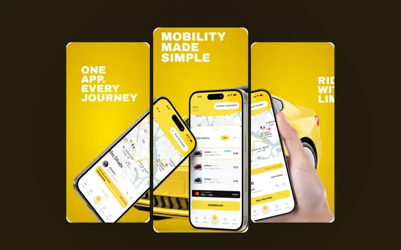<br/>
      <b>TAGGO Ride &amp; Cargo</b><br/>
      <sub>UAE ride-hailing &amp; cargo · Flutter · Laravel · Gemini voice assistant</sub><br/>
      <a href="https://apps.apple.com/ae/app/taggo-ride-cargo/id6756260610"></a>
      <a href="https://play.google.com/store/apps/details?id=ae.kief.taggo"></a>
    </td>
    <td align="center" width="33%">
      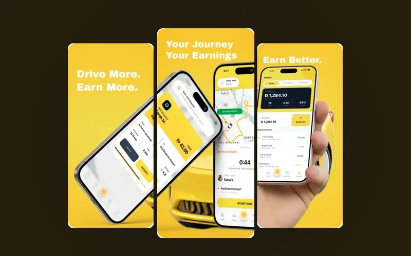<br/>
      <b>TAGGO Captain</b><br/>
      <sub>Driver &amp; delivery-partner app · jobs, navigation, wallet</sub><br/>
      <a href="https://apps.apple.com/ae/app/taggo-captain/id6784939884"></a>
      <a href="https://play.google.com/store/apps/details?id=ae.kief.taggodriver.taggo_driver"></a>
    </td>
    <td align="center" width="33%">
      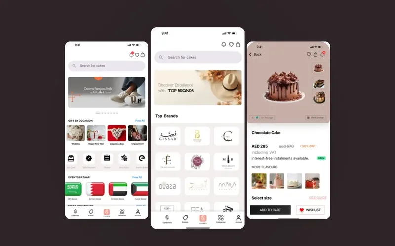<br/>
      <b>The Events</b><br/>
      <sub>Multi-vendor marketplace · 100+ vendors · AI shopping agent</sub><br/>
      <a href="https://apps.apple.com/ae/app/theevents-gifts-shopping/id6739205204"></a>
      <a href="https://play.google.com/store/apps/details?id=com.logicalyinfotech.events"></a>
    </td>
  </tr>
</table>

### 🌐 Web platforms & stores

<table>
  <tr>
    <td align="center" width="33%">
      <a href="https://taggo.ae/en">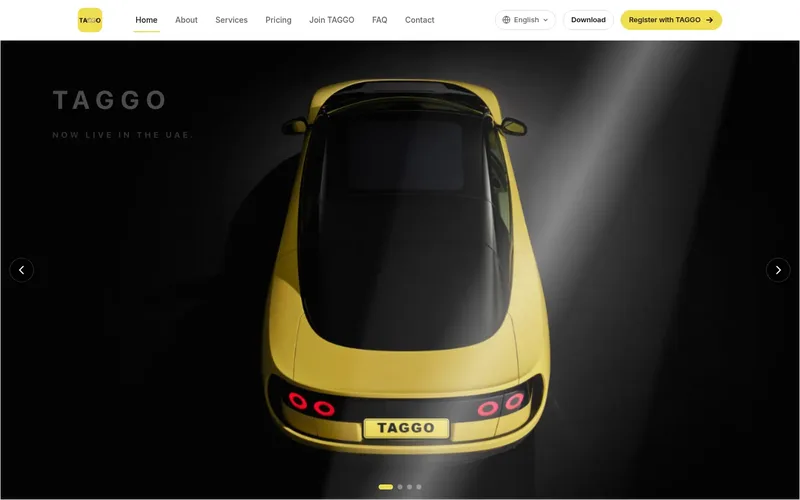</a><br/>
      <b><a href="https://taggo.ae/en">TAGGO</a></b><br/><sub>Bilingual EN/AR mobility platform · Next.js</sub>
    </td>
    <td align="center" width="33%">
      <a href="https://theevents.ae">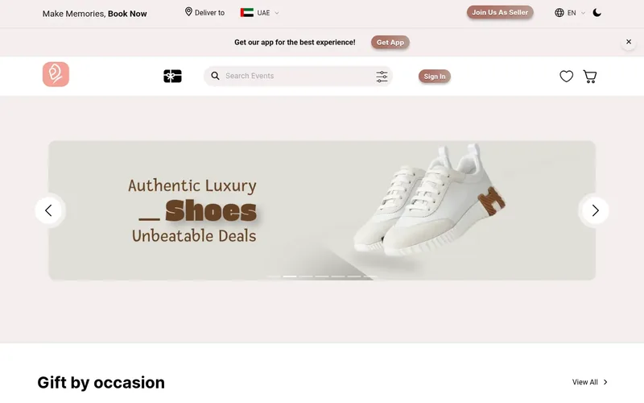</a><br/>
      <b><a href="https://theevents.ae">The Events</a></b><br/><sub>Marketplace web · Next.js · Laravel · pgvector</sub>
    </td>
    <td align="center" width="33%">
      <a href="https://clinicclick.ae">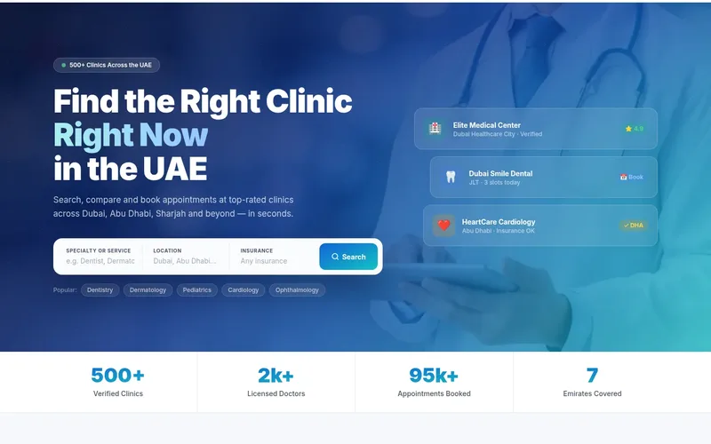</a><br/>
      <b><a href="https://clinicclick.ae">ClinicClick</a></b><br/><sub>UAE clinic booking marketplace · 500+ clinics</sub>
    </td>
  </tr>
  <tr>
    <td align="center" width="33%">
      <a href="https://marcoroma.ae">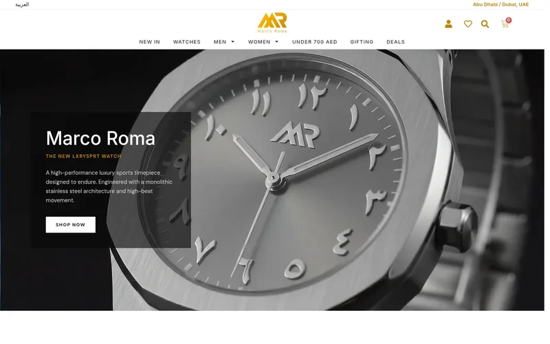</a><br/>
      <b><a href="https://marcoroma.ae">Marco Roma</a></b><br/><sub>Luxury watches · WooCommerce · Tabby · UAE VAT</sub>
    </td>
    <td align="center" width="33%">
      <a href="https://stajr.com">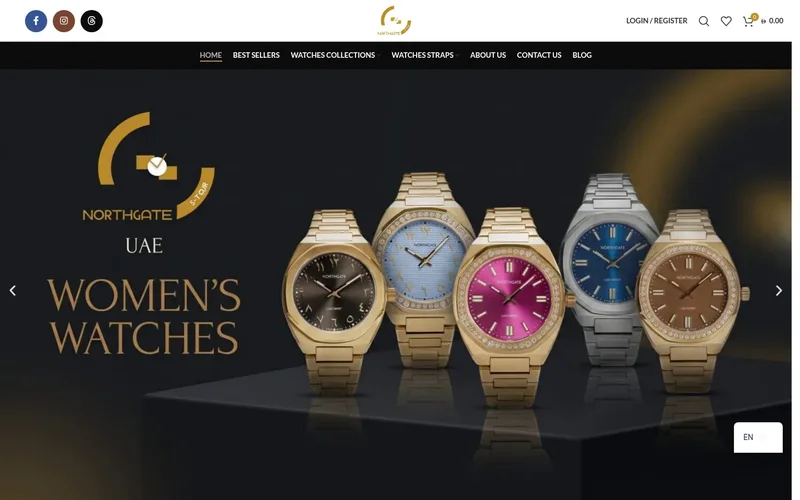</a><br/>
      <b><a href="https://stajr.com">Stajr</a></b><br/><sub>Bilingual luxury watch store · WoodMart</sub>
    </td>
    <td align="center" width="33%">
      <a href="https://monayadiamond.com">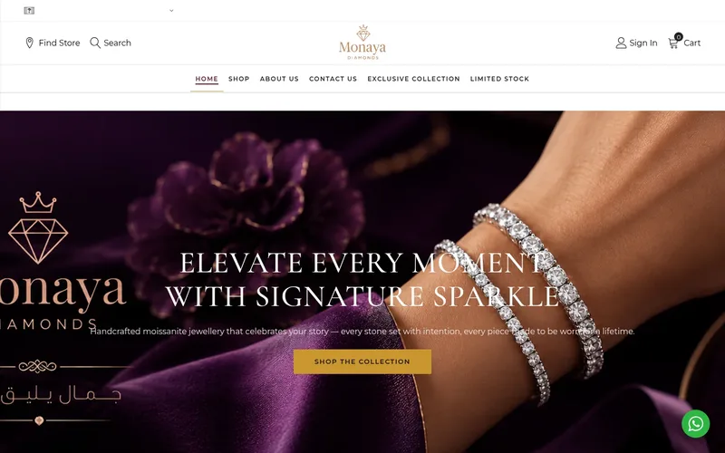</a><br/>
      <b><a href="https://monayadiamond.com">Monaya Diamond</a></b><br/><sub>Luxury jewellery · EN/AR · Tabby checkout</sub>
    </td>
  </tr>
</table>

<p align="center"><a href="https://www.lifeofhaseeb.com"></a></p>

---

### 🧩 Open-source

Small, useful AI-automation tools I publish regularly.

<!-- OPEN_SOURCE_LIST
| Project | What it does |
|---|---|
| [whatsapp-cloud-mcp](https://github.com/workofhaseeb-cyber/whatsapp-cloud-mcp) | MCP server for the WhatsApp Business Cloud API |
-->
<sub>First releases coming soon. Follow to get notified.</sub>

---

### 🏅 Certifications

<p align="center">
  
  <a href="https://academy.claude.com/verify/45fcef43ef414d541d8aff5a9948bf5e"></a>
  
</p>

---

### 📊 GitHub analytics

<p align="center">
  
  
</p>

<p align="center">
  
</p>

<p align="center">
  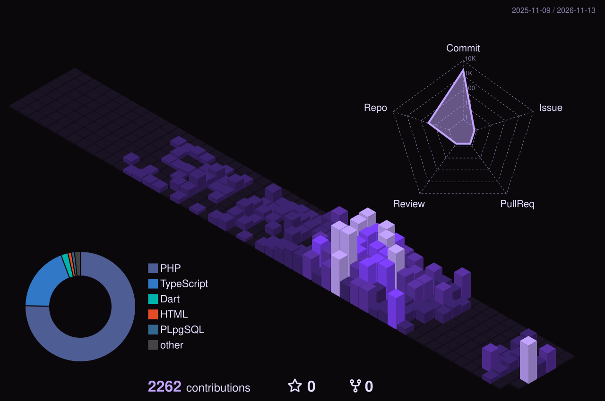
</p>

<p align="center">
  
</p>

<p align="center">
  
</p>

<!-- ============ FOOTER ============ -->
<!-- Stats, 3D calendar and snake refresh daily via .github/workflows/profile-assets.yml -->
<p align="center">
  <i>Most of my work lives in private client repositories. Private contributions are counted above.</i>
</p>

<p align="center">
  
</p>
